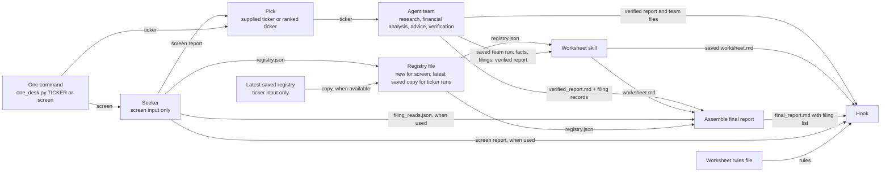

# Checkpoint 3 — Team desk proposal

**Team: Team 3**   
**Members:** Shlok, Sam, and Ryan

## Desk design

From PowerShell: `.\.venv\Scripts\python.exe one_desk.py TICKER` or `.\.venv\Scripts\python.exe one_desk.py screen`.

The pipeline join is implemented in `one_desk.py`. A `screen` run calls the seeker and then selects a ticker; a ticker run uses the ticker supplied and copies the latest saved seeker registry when available. For `screen`, the seeker report, registry, and filing-read log are saved in that run folder. A ticker run copies the latest registry when one exists. Both paths save the team files, worksheet, final report, and `run.json`. The agent team saves its run under `team/`. The worksheet runs as a separate pipeline step on that saved team run and registry. One Desk combines the filing list, verified team report, and worksheet output in `final_report.md`. The hook checks the worksheet and final report, and checks the seeker report when the run used `screen`. The worksheet is not currently called as a tool by an analyst role.

## What the team owns

The team owns the spinoff factor check. The initial protocol is in the [factor-check protocol](factor_check_protocol.md). It proposes one comparison: average benchmark-adjusted return for the 75-point group minus the zero-point group. The historical WRDS test is not built. Freeze the final protocol before accessing the selected historical returns and record later changes.

## Member roles

- **Shlok — Desk integration and live runs:** maintain the `one_desk.py` pipeline and README run instructions; coordinate the ticker runs and assemble the live report with its filing list, view, and timing record.
- **Sam — Spinoff factor check:** maintain `spinoff_factors.json`, `docs/factor_check_protocol.md`, and the supporting seeker registry evidence; document which factor inputs are sourced, missing, or unverified.
- **Ryan — Worksheet and validation:** maintain the worksheet guard and hook configuration in `.agents/skills/us-spinoff-worksheet/` and `.codex/hooks.json`; run offline replay checks and save their proof files.

## Live record so far

The local records are under [runs/live/](../runs/live/). Times are Eastern. The response window is 24 hours after EDGAR acceptance. A commit inside that window does not by itself establish that a view was made before the market reaction. Commit times below come from repository history when available; a dash means a time was not established.

| Member | Report and filing | EDGAR acceptance | Commit or copy status | Within 24 hours? | View and limitations |
| --- | --- | --- | --- | --- | --- |
| Shlok | [Take-Two (TTWO), earnings 8-K](../runs/live/Week%2011-9to11-15/Shlok_TTWO_VYLR/report.md) | Nov. 9, 2026, 4:10:58 p.m. | Draft 2 identifies commit 080ebba, Nov. 14, 2:56:50 a.m.; the current runs/live path was added in 41611e7, Nov. 14, 6:53:22 p.m. | No | View was after the first post-filing close and was not computed. |
| Sam | [Sagard Private Income Fund, Form D](../runs/live/Week%2011-9to11-15/Sam_Sagard_HONA/report.md) | Nov. 10, 2026, 4:17:15 p.m. | 41611e7, Nov. 14, 6:53:22 p.m. | Spin-off | Unlisted; no exchange price or reaction. HONA is the related spinoff worksheet. |
| Ryan | [Lucid Group (LCID), Form 4](../runs/live/Week%2011-9to11-15/Ryan_LCID_REZI/report.md) | Nov. 13, 2026, 4:10:11 p.m. | 41611e7, Nov. 14, 6:53:22 p.m. | No; about 26.7 hours | No post-filing close was available in the saved record; view not computed. REZI is the related spinoff worksheet. |
| Shlok | [Tyson Foods (TSN), earnings 8-K 0000100493-26-000077](../runs/live/Week%2011-16to11-22/Shlok_TSN_GEV/report.md) | Nov. 16, 2026, 7:41:53 a.m. | da44970, Nov. 17, 9:05:49 p.m. | No; about 37.4 hours | View recorded Nov. 17, 4:38:18 p.m., 32.94 hours after acceptance and after the Nov. 16 first post-filing close of $63.95. |
| Shlok | [GE Vernova (GEV), spinoff worksheet](../runs/live/Week%2011-16to11-22/Shlok_TSN_GEV/worksheet-20261117-manual-ge-10k/worksheet.md) | FY2025 10-K: Jan. 29, 2026, 4:16:47 p.m.; Information Statement: March 8, 2024, 4:49:59 p.m. | Saved with the TSN/GEV run in da44970, Nov. 17, 9:05:49 p.m. | Spin-off | Source review updated Nov. 17, 8:27 p.m. The worksheet is not a response to GEV's latest earnings release. |
| Ryan / partner test | [NVIDIA (NVDA), earnings 8-K 0001045810-26-000088](../runs/live/Week%2011-16to11-22/Ryan_NVDA/NVDA_2026-11-17_17-58-48_452442_-0500/final_report.md) | Nov. 17, 2026, 4:20:51 p.m. | Original one_desk_runs report: da44970, Nov. 17, 9:05:49 p.m. | Yes; original commit about 4.7 hours after filing | Reviewed worksheet view: less than price. The same run is the Lab 09 partner test; it is not a second independent run. |
| Sam | [Walmart (WMT), earnings 8-K 0000104169-26-000168](../runs/live/Week%2011-16to11-22/Sam_WMT/WMT_2026-11-19_21-11-20_008030_-0500/final_report.md) | Nov. 19, 2026, 6:58:52 a.m. | [Commit d277b85](https://github.com/WSDx07/Equity-Research-Report---AI-analyst-buddy/commit/d277b85719ad556c091162ccc427fde40984e8b4), Nov. 19, 9:41:13 p.m. ET | Yes; commit about 14 hours, 42 minutes after acceptance | Run started at 9:11:20 p.m.; worksheet saved at 9:15:07 p.m. View not computed because the saved run has no market-price reader. |
| Partner test | [The Home Depot (HD), earnings 8-K 0000354950-26-000184](../one_desk_runs/HD_2026-11-17_18-02-41_505834_-0500/final_report.md) | Nov. 17, 2026, 6:18:03 a.m. | Original partner report: da44970, Nov. 17, 9:05:49 p.m. | Yes; original commit about 14.8 hours after filing | Reviewed worksheet view: less than price. |
| Ryan | [Hewlett Packard Enterprise (HPE), earnings 8-K 0001645590-26-000097](../runs/live/Week%2011-23to11-29/Ryan_HPE/HPE_2026-11-23_17-21-47_220163_-0500/final_report.md) | Nov. 23, 2026, 4:12:08 p.m. | Commit 89c7f94, Nov. 23, 5:25:23 p.m. ET | Yes; commit about 1 hour, 13 minutes after acceptance | Worksheet saved at 5:25:12 p.m., before the first post-filing close on Nov. 24. The view was not computed because no market-price reader was available. |
| Shlok | [Dollar Tree (DLTR), earnings 8-K 0000935703-26-000136](../runs/live/Week%2011-23to11-29/Shlok_DLTR_SOLV/report.md) | Nov. 24, 2026, 6:30:42 a.m. | Commit dedc2a9, Nov. 24, 8:21:02 p.m. ET | Yes; commit about 13 hours, 50 minutes after acceptance | Low case: $69.24/share vs. $139.10 pre-release close (-50.22%). View recorded at 8:14:45 p.m., after the Nov. 24 close of $154.65; not a pre-reaction view. |
| Shlok | [Solventum (SOLV), spinoff worksheet](../runs/live/Week%2011-23to11-29/Shlok_DLTR_SOLV/worksheet.md) | SOLV FY2025 10-K: Feb. 27, 2026; Q3 10-Q: Nov. 5, 2026. | Same folder commit dedc2a9, Nov. 24, 8:21:02 p.m. ET | Spinoff worksheet; not a response to a release this week | Low case: $21.49/share vs. $88.16 close (-75.63%). TTM earnings may retain part of a gain on sale; debt, parent-liability, restriction, and insider-purchase evidence remain incomplete. |

### Lab 09 partner test

The partner selected NVIDIA and The Home Depot. NVIDIA is in the [Week 4 starting set](https://cinderzhang.github.io/FIN67110-Fall2026/week-04/index.html#application--the-live-records-companies). The NVDA run includes the [three-column comparison](../one_desk_runs/NVDA_2026-11-17_17-58-48_452442_-0500/team/lab09_three_column_comparison.md); both original run folders include offline replay proofs. The partner reports received manual source review. The saved verifier outputs still flag claims for follow-up.

### Live record by week

#### Nov. 9-15, 2026

- **Shlok - TTWO / VYLR:** Take-Two was the live-release company, and Vylor was the spinoff worksheet company. The TTWO view was not computed and was recorded after the first post-filing close. The saved record was outside the 24-hour window.
- **Sam - Sagard / HONA:** Sagard was the live filing, and Honeywell Aerospace was the spinoff worksheet company. Sagard was unlisted, so no exchange-price reaction was available. The saved record was outside the 24-hour window.
- **Ryan - LCID / REZI:** Lucid was the live filing, and Resideo was the spinoff worksheet company. The LCID view was not computed; the saved record was outside the 24-hour window.

#### Nov. 16-22, 2026

- **Shlok - TSN / GEV:** Tyson was the live-release company, and GE Vernova was the spinoff worksheet company. The TSN view was computed but recorded 32.94 hours after filing and after the first post-filing close. The GEV worksheet was not a current earnings-release view.
- **Sam - WMT:** Walmart's release run started Nov. 19 at 9:11:20 p.m.; its worksheet was saved at 9:15:07 p.m. The report was committed as d277b85 at 9:41:13 p.m., 14 hours and 42 minutes after EDGAR acceptance. Its view remains not computed because the saved run has no market-price reader.
- **Ryan / partner test - NVDA:** The reviewed NVIDIA report has a "less than price" view. Its original partner-run report was committed about 4.7 hours after filing.
- **Partner test - HD:** The reviewed Home Depot report has a "less than price" view. Its original partner-run report was committed about 14.8 hours after filing.

#### Nov. 23-29, 2026

- **Ryan - HPE:** EDGAR accepted the earnings 8-K on Nov. 23 at 4:12:08 p.m. The worksheet was saved at 5:25:12 p.m. and the report was committed at 5:25:23 p.m. The commit was within 24 hours and preceded the first post-filing close on Nov. 24, but the view was not computed because the saved run had no market-price reader.
- **Shlok - DLTR / SOLV:** The DLTR earnings 8-K was accepted Nov. 24 at 6:30:42 a.m. The source-reviewed view was recorded at 8:14:45 p.m. and committed at 8:21:02 p.m. Its low case was $69.24/share against the $139.10 pre-release close, a -50.22% margin of safety. The view was recorded after the first post-filing close, so it is not a pre-reaction view. SOLV is the spinoff worksheet company; its low case was $21.49/share against the $88.16 close, a -75.63% margin of safety. The TTM earnings base may retain part of a reported gain on sale, and several financing and insider-purchase facts remain unknown. See the [weekly report](../runs/live/Week%2011-23to11-29/Shlok_DLTR_SOLV/report.md) and [worksheet](../runs/live/Week%2011-23to11-29/Shlok_DLTR_SOLV/worksheet.md).
