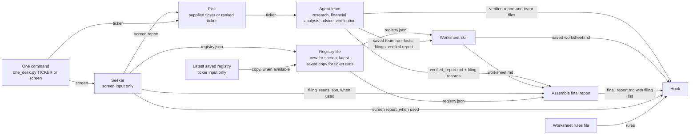

# Checkpoint 3 — Team desk proposal

**Team: Team 3**   
**Members:** Shlok, Sam, and Ryan

## Desk design

From PowerShell: `.\.venv\Scripts\python.exe one_desk.py TICKER` or `.\.venv\Scripts\python.exe one_desk.py screen`.

The pipeline join is implemented in `one_desk.py`. A `screen` run calls the seeker and then selects a ticker; a ticker run uses the ticker supplied and copies the latest saved seeker registry when available. For `screen`, the seeker report, registry, and filing-read log are saved in that run folder. A ticker run copies the latest registry when one exists. Both paths save the team files, worksheet, final report, and `run.json`. The agent team saves its run under `team/`. The worksheet runs as a separate pipeline step on that saved team run and registry. One Desk combines the filing list, verified team report, and worksheet output in `final_report.md`. The hook checks the worksheet and final report, and checks the seeker report when the run used `screen`. The worksheet is not currently called as a tool by an analyst role.

## What the team owns

The team owns the spinoff factor check. The initial protocol is in the [factor-check protocol](factor_check_protocol.md). It proposes one comparison: average benchmark-adjusted return for the 75-point group minus the zero-point group. The historical WRDS test is not built. Freeze the final protocol before accessing the selected historical returns and record later changes.

## Member roles

- **Shlok — Desk integration and live runs:** maintain the `one_desk.py` pipeline and README run instructions; coordinate the ticker runs and assemble the live report with its filing list, view, and timing record.
- **Sam — Spinoff factor check:** maintain `spinoff_factors.json`, `docs/factor_check_protocol.md`, and the supporting seeker registry evidence; document which factor inputs are sourced, missing, or unverified.
- **Ryan — Worksheet and validation:** maintain the worksheet guard and hook configuration in `.agents/skills/us-spinoff-worksheet/` and `.codex/hooks.json`; run offline replay checks and save their proof files.

## Live record so far

See [`runs/live/`](../runs/live/) for the prior week and current week records.

### Nov. 9–15 prior week

| Member | Company and filing                        | Filing time (Eastern)       | Saved view/status                                              |
| ------ | ----------------------------------------- | --------------------------- | -------------------------------------------------------------- |
| Shlok  | Take-Two Interactive (TTWO), earnings 8-K | Nov. 9, 2026, 4:10:58 p.m.  | View was after the first post-filing close; view not computed. |
| Sam    | Sagard Private Income Fund, Form D        | Nov. 10, 2026, 4:17:15 p.m. | Unlisted; no exchange price or reaction.                       |
| Ryan   | Lucid Group (LCID), Form 4                | Nov. 13, 2026, 4:10:11 p.m. | No post-filing close; view not computed.                       |

### Nov. 16–22 current week: Shlok

Selections: TSN and GEV.

| Member | Report                                                                                                      | Filing time (Eastern)                                                                                                                                                                                                                                                                                                                                                                                                                                                                                                                                                                                              | Report or view time (Eastern)                                                                                                                   |
| ------ | ----------------------------------------------------------------------------------------------------------- | ------------------------------------------------------------------------------------------------------------------------------------------------------------------------------------------------------------------------------------------------------------------------------------------------------------------------------------------------------------------------------------------------------------------------------------------------------------------------------------------------------------------------------------------------------------------------------------------------------------------ | ----------------------------------------------------------------------------------------------------------------------------------------------- |
| Shlok  | Tyson Foods (TSN), earnings release Form 8-K, accession 000010049326000077                                  | Nov. 16, 2026, 7:41:53 a.m. [EDGAR filing](https://www.sec.gov/Archives/edgar/data/100493/000010049326000077/0000100493-26-000077-index.htm)                                                                                                                                                                                                                                                                                                                                                                                                                                                                       | View recorded Nov. 17, 2026, 4:38:18 p.m.; 32.94 hours after filing. First post-filing close was $63.95 on Nov. 16, from the saved LSEG reader. |
| Shlok  | GE Vernova (GEV), spinoff worksheet; FY2025 Form 10-K plus original Form 10 and final Information Statement | Valuation Form 10-K accepted Jan. 29, 2026, 4:16:47 p.m. ET; final Information Statement accepted Mar. 8, 2024, 4:49:59 p.m. ET. Latest GEV earnings 8-K was accepted Oct. 28, 2026, 6:16:59 a.m. ET; the worksheet is not a response view to that release. [10-K](https://www.sec.gov/Archives/edgar/data/1996810/000199681026000015/0001996810-26-000015-index.htm), [Information Statement](https://www.sec.gov/Archives/edgar/data/1996810/000119312524063739/0001193125-24-063739-index.htm), [latest 8-K](https://www.sec.gov/Archives/edgar/data/1996810/000199681026000162/0001996810-26-000162-index.htm) | Source review updated Nov. 17, 2026, 8:27 p.m. ET; no GEV live-release view.                                                                    |

### Lab 09 partner test: 

The  partner selected NVIDIA (NVDA) and The Home Depot (HD). Both filed earnings releases on 2026-11-17. NVIDIA appears in the Week 4 starting set for partner picks. [Week 4 page](https://cinderzhang.github.io/FIN67110-Fall2026/week-04/index.html#application--the-live-records-companies)

| Partner pick        | Release filing                                                                               | Saved run                                                  | Lab 09 artifact                                                    |
| ------------------- | -------------------------------------------------------------------------------------------- | ---------------------------------------------------------- | ------------------------------------------------------------------ |
| NVIDIA (NVDA)       | Form 8-K, accession 0001045810-26-000088; accepted 2026-11-17 21:20:51 UTC (4:20:51 p.m. ET) | one\_desk\_runs/NVDA\_2026-11-17\_17-58-48\_452442\_-0500/ | Reviewed report, completed worksheet, and three-column comparison. |
| The Home Depot (HD) | Form 8-K, accession 0000354950-26-000184; accepted 2026-11-17 11:18:03 UTC                   | one\_desk\_runs/HD\_2026-11-17\_18-02-41\_505834\_-0500/   | Reviewed report and completed worksheet.                           |
